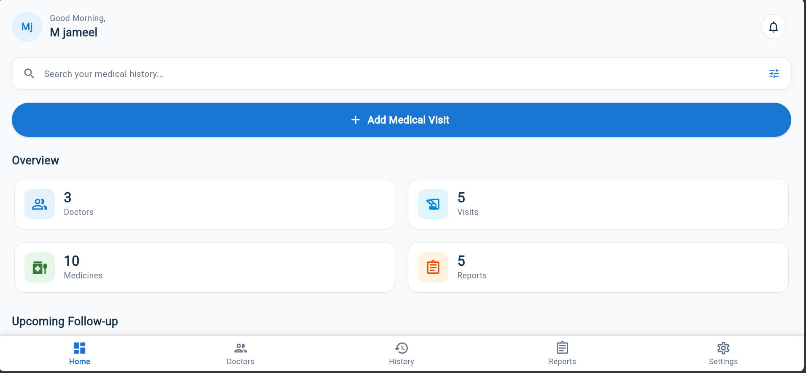

# My Medical History 🏥

A comprehensive, secure personal medical history and record management mobile/web application built with Flutter.

## Features ✨
- **Secure App Lock**: 4-digit PIN lock screen protection with visible digit boxes on app startup.
- **Patient Profile**: Manage personal medical profile (**M jameel**, `jameelkharal70@gmail.com`, `03034086970`).
- **Doctors Directory & Visit History**: Support for multiple independent medical visits per doctor.
- **Multi-Step Medical Visit Flow**: Record diagnoses, symptoms, medicines, tests, and prescription attachments.
- **Medicines & Reports Library**: Organize medical reports and prescriptions with PDF/image previews.
- **Google Drive Backup & Sync**: Seamless cloud backup and synchronization.

## App Screenshots 📱

### 1. Overview

### 2. Screen 1

### 3. Screen 2

### 4. Screen 3

### 5. Screen 4

### 6. Screen 5

### 7. Screen 6

## Getting Started
- Run `flutter pub get` to install dependencies.
- Run `flutter run` to launch the application.
